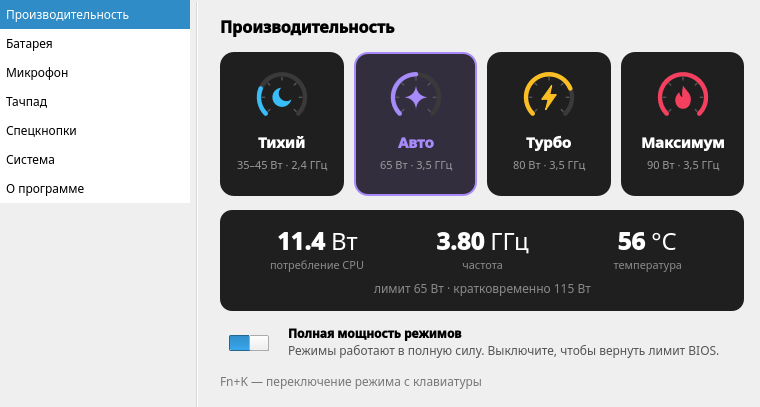
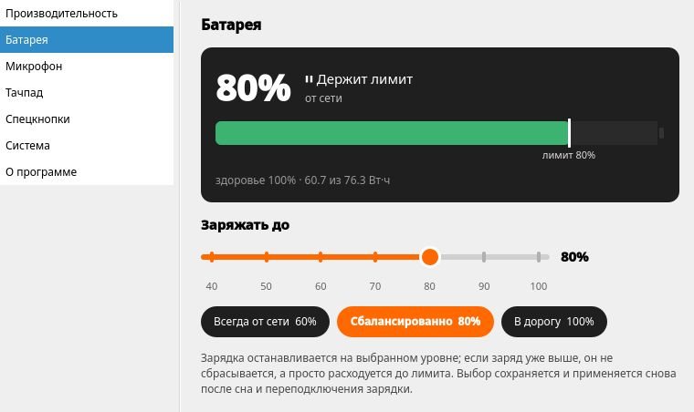
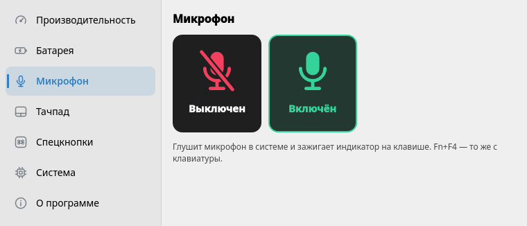
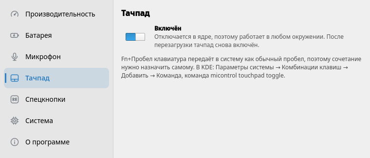
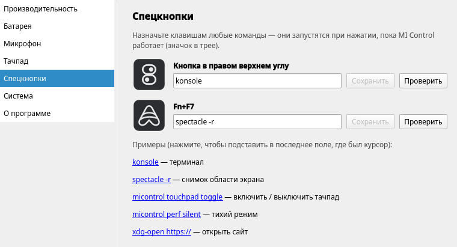

# MI Control для Linux

Управление функциями ноутбуков Xiaomi / REDMI Book в Linux: режимы производительности,
лимит заряда батареи, индикатор микрофона. Порт
[MI Control Utility](https://github.com/loginsinex/micontrol) (Windows) на Rust + Qt 6 / QML.

*Linux port of MI Control Utility for Xiaomi / REDMI Book laptops: performance modes,
battery charge limit, microphone LED. Rust + Qt 6.*

| Производительность | Батарея | Микрофон |
|---|---|---|
|  |  |  |
| **Тачпад** | **Спецкнопки** | |
|  |  | |

## Возможности

- **Режимы производительности**: тихий, авто, турбо, максимум (на старых моделях — баланс).
  Опция «Полная мощность режимов» снимает ограничение BIOS PL1 = 28 Вт, без неё режимы
  меняют в основном работу вентиляторов. Fn+K переключает режимы по кругу. Лимит мощности
  каждого режима программа узнаёт сама на вашем ноутбуке — от сети и от батареи отдельно —
  и показывает на плитках.
- **Лимит заряда**: 40–90% или без ограничения; демон применяет его снова после сна и
  переподключения зарядки.
- **Микрофон**: mute в PipeWire и индикатор на клавише.
- **Тачпад**: отключение в окне, в трее или командой `micontrol touchpad toggle`, которую
  можно повесить на любое сочетание клавиш (Fn+Пробел до системы не доходит).
- **Спецкнопки**: кнопка в правом верхнем углу клавиатуры и Fn+F7 запускают любые команды,
  заданные в окне.
- **Мониторинг**: потребление и частота CPU, температура, мощность заряда/разряда, здоровье батареи.
- **Значок в трее**: текущее состояние и быстрое переключение по правому клику.

Что нового — в [CHANGELOG.md](CHANGELOG.md).

## Проверенные модели

| Модель | SKU | BIOS | Статус |
|---|---|---|---|
| REDMI Book Pro 14 2025 | TM2411 | RMAAR4B0P0505 | всё работает |
| REDMI Book Pro 16 2025 | TM2409 | RMAAR6B0P0707, RMAAR6B0P0808 | всё работает¹ |

¹ Лимиты мощности отличаются от 14-дюймовой модели: от сети DTT даёт 33/49–64/75/95 Вт
(тихий/авто/турбо/максимум), от батареи — 25/70/70/70 Вт.

Другие ноутбуки Xiaomi с WMI-интерфейсом `MiInterface` скорее всего тоже подойдут
(в оригинальном MIControl — RedmiBook / Xiaomi Book разных лет), но не проверены.
Помогите расширить список — см. [«Проверка своей модели»](#проверка-своей-модели).

## Требования и ограничения

- Модуль ядра [`acpi_call`](https://github.com/nix-community/acpi_call): через него идут вызовы
  прошивки. Исходники лежат в `third_party/acpi_call`, нужны заголовки ядра (`kernel-devel` /
  `linux-headers`).
- **Secure Boot**: собранный вручную модуль не загрузится, пока он не подписан ключом, внесённым
  в MOK. С выключенным Secure Boot всё работает как есть.
- Демон `micontrold` работает от root; GUI и CLI — от обычного пользователя через Unix-сокет.

## Установка

Готовые файлы — на странице [Releases](https://github.com/AbyssMoon/micontrol-linux/releases/latest).
Пакеты ставят демон, который запускается при старте системы, значок в трее при входе в сеанс
и модуль `acpi_call`, который DKMS пересобирает под каждое новое ядро.

**Fedora 44+** (`micontrol-<версия>-1.fc44.x86_64.rpm`):

```sh
sudo dnf install ./micontrol-*.rpm      # подтянет dkms и kernel-devel
sudo dnf remove micontrol               # удалить (настройки в /var/lib/micontrol остаются)
```

**Ubuntu 24.04+, Debian 13+, Linux Mint 22+** (`micontrol_<версия>_amd64.deb`):

```sh
sudo apt install ./micontrol_*_amd64.deb   # подтянет dkms и заголовки ядра
sudo apt remove micontrol                  # удалить; apt purge — вместе с настройками
```

**Другие дистрибутивы** — переносная сборка, в систему ничего не ставит:

```sh
tar xf micontrol-portable.tar.xz && cd micontrol-portable
./build-acpi_call.sh   # один раз: собрать модуль под своё ядро
./run.sh probe         # только чтение: проверить, что прошивка отвечает
./run.sh               # демон (sudo) + окно; выход — через меню в трее
./run.sh --mock        # интерфейс без железа и без root
```

После установки пакета: окно — «MI Control» в меню приложений, CLI — `micontrol status`,
лог демона — `journalctl -u micontrold`.

### Secure Boot

С включённым Secure Boot модуль `acpi_call` загрузится, только если подписан ключом из MOK.
DKMS подписывает его сам, но ключ нужно один раз внести в прошивку:

```sh
# Ubuntu / Debian (при установке DKMS может сам предложить это и спросить пароль)
sudo mokutil --import /var/lib/shim-signed/mok/MOK.der
# Fedora
sudo mokutil --import /var/lib/dkms/mok.pub
```

Задайте одноразовый пароль, перезагрузитесь, на синем экране MOK Manager выберите
«Enroll MOK» и введите его. Проверка: `lsmod | grep acpi_call`.

### Что ставят пакеты

`/opt/micontrol` (программа со встроенным Qt 6), `micontrold.service`, `/usr/src/acpi_call-*`
для DKMS, `/usr/lib/modules-load.d/acpi_call.conf`, ярлык в меню, автозапуск
`/etc/xdg/autostart/micontrol.desktop` (`micontrol-gui --tray`), команды `micontrol` и
`micontrol-gui`. Повторный запуск `micontrol-gui` открывает окно уже запущенного экземпляра.

## Сборка из исходников

Тулчейн ставится в `.toolchain/` внутри проекта (Rust через rustup, Qt 6.8.3 через aqtinstall).
Нужны `curl`, `python3`, `gcc`/`g++`, `make` и системная `libGL`.

```sh
./scripts/setup-toolchain.sh
source env.sh
cargo build --workspace
cargo test --workspace

./scripts/build-acpi_call.sh      # → build/acpi_call/acpi_call.ko
./scripts/make-portable.sh        # → dist/micontrol-portable и .tar.xz
./scripts/make-rpm.sh             # → dist/micontrol-*.rpm (нужен rpmbuild)
./scripts/make-deb.sh             # → dist/micontrol_*_amd64.deb (нужен dpkg-deb)
```

Разработка без ноутбука Xiaomi:

```sh
export MICONTROL_SOCKET=$XDG_RUNTIME_DIR/micontrol-dev.sock
./target/debug/micontrold --mock --socket $MICONTROL_SOCKET --state /tmp/mc-state.json &
./target/debug/micontrol-gui
```

Отладка на ноутбуке: `sudo ./scripts/dev-daemon.sh` запускает демон с `--debug`
(сокет доступен только вашему пользователю), после чего `micontrol dbg get|set …` делает
произвольные вызовы прошивки без root.

## Проверка своей модели

```sh
./scripts/build-acpi_call.sh
sudo ./scripts/probe-hw.sh        # ТОЛЬКО ЧТЕНИЕ, ничего не меняет → build/probe/
```

Откройте issue с файлом `build/probe/calls.txt` и архивом `build/probe/tables/`
(ACPI-таблицы — по ним видно, какие команды понимает прошивка).

## Как это работает

Вызовы идут в ACPI-метод `\_SB.PC00.WMID.WMAA` (WMI `MiInterface`, GUID
`B60BFB48-3E5B-49E4-A0E9-8CFFE1B3434B`) через `acpi_call`. Буфер 32 байта:
`{00, FB|FA, 00, CMD, ARG, 00, ARG2, 00, …}` (`FB` — запись, `FA` — чтение). В ответе байт 1 —
статус (`80` — успех, `E0` — не поддерживается), значения — в байтах 4 и 6.

| Функция | CMD | Значения |
|---|---|---|
| Режим производительности | `0x08` | 02 тихий, 03 турбо, 04 максимум, 09 авто (01 баланс — старые модели) |
| Микрофон | `0x0A`, ARG `0x05` | ARG2: 1 — включён, 0 — выключен |
| Лимит заряда | `0x10`, ARG `0x02` | ARG2: 00 выкл, 04 90%, 01 80%, 05 70%, 06 60%, 07 50%, 08 40% |
| Здоровье батареи | `0x10`, ARG `0x01` | ARG2: проценты (только чтение) |

Значения сверены с ACPI-таблицами REDMI Book Pro 14 2025 (SSDT `XMCC1806`). Прошивка
отвечает «успех» и на неподдерживаемые значения (например, режим 01 на моделях 2025),
поэтому демон перечитывает значение после записи.

Режим прошивка передаёт в Intel DTT (`ODVP1`), и `thermald --adaptive` выставляет PL1 из
таблиц Xiaomi — но только в MMIO-домен RAPL. В MSR-домене остаётся 28 Вт от BIOS, а действует
меньший из лимитов; «Полная мощность режимов» копирует PL1 из DTT в MSR.

Драйвер ядра `bitland-mifs-wmi` работает с тем же интерфейсом, но с чужими значениями режимов:
его `platform_profile` на этих моделях не читается, а запись `low-power` (профиль
«Энергосбережение» в tuned-ppd / power-profiles-daemon) включает тихий режим.

## Устройство

- `crates/micontrol-core` — протокол, бэкенды (`acpi_call`, `mock`), IPC, powercap, DMI.
- `crates/micontrold` — демон (root): вызовы прошивки, сохранение настроек, повторное
  применение лимита после сна и смены питания, синхронизация PL1.
- `crates/micontrol-cli` — `micontrol`: клиент демона, `probe` / `raw` / `dbg` для отладки.
- `crates/micontrol-gui` — интерфейс на QML (cxx-qt) со значком в трее.

## Документация

- [docs/DEVELOPMENT.md](docs/DEVELOPMENT.md) — архитектура, IPC, отладка на железе, как добавить
  функцию или модель, релиз, известные проблемы.
- [docs/FIRMWARE.md](docs/FIRMWARE.md) — справочник по `WMAA`, событиям WMI, DTT и лимитам
  мощности, открытые вопросы.
- [CONTRIBUTING.md](CONTRIBUTING.md) — как проверить свою модель и прислать данные.

## Лицензия

GNU GPL v3 или новее (как и оригинальный MIControl). `third_party/acpi_call` — GPL v3,
© авторы acpi_call.

Проект не связан с Xiaomi. Используйте на свой страх и риск.
